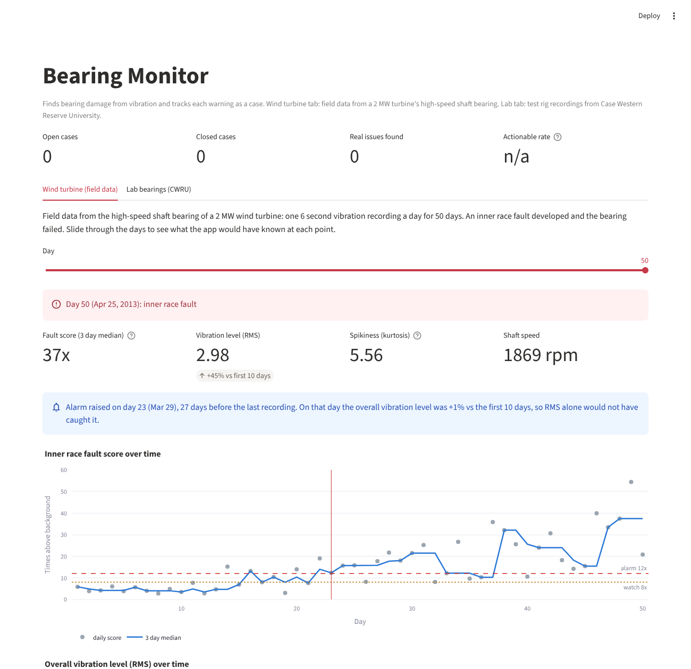
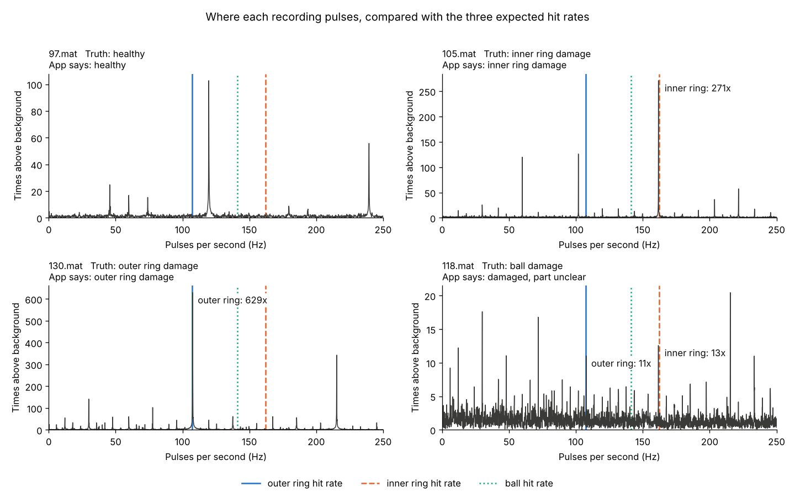

# Bearing Monitor

A small condition monitoring app. It reads bearing vibration recordings, finds signs of damage, names the damaged part, and tracks each warning as a case in a SQL database.

It has two parts:

- **Wind turbine:** 50 days of field vibration data from the high-speed shaft bearing of a 2 MW wind turbine, where an inner race fault developed and the bearing failed. The app tracks the fault day by day and shows when it would have raised the alarm.
- **Lab bearings:** four test rig recordings with known damage, used to show the app naming the damaged part.

I built it to understand how monitoring and diagnostics teams catch bearing problems before they turn into failures,
I also wanted to get a small understanding of what type of work is done in the industry side. 

**Live demo:** https://bearing-monitor-tom.streamlit.app/



## What it does

1. **Finds damage.** A damaged bearing makes a tiny impact every time a ball rolls over the bad spot. The app filters for the ringing those impacts cause, takes the outline of it (the envelope), and looks at how often the outline repeats. This is called envelope analysis.
2. **Names the part.** The outer ring, inner ring and balls each get hit at their own rate, set by the bearing's shape and the shaft speed. The app checks for a strong pulse at each rate.
3. **Logs a case.** Every warning is saved as a case in a SQLite database. A case is later closed as a real issue or a false alarm.
4. **Shows every bearing at a glance.** Each recording gets a status card: green for healthy, red when the damaged part is named, yellow when it is damaged but the part is unclear. Click a card to see its spectrum and scores.
5. **Watches a real turbine over time.** On the wind turbine tab, a day slider replays the 50 days. The app only uses data up to the chosen day, so you can see when it would have warned.
6. **Tracks the results.** The dashboard shows open cases, closed cases, and the actionable rate, which is the share of closed cases that were real issues.

## Results

### Wind turbine (field data)

| | Day | Fault score (3 day median) | Overall vibration (RMS) vs first 10 days |
|---|---|---|---|
| Healthy period | 1 to 13 | about 4x | normal |
| First watch | 14 | rising, single days over 12x | +11% |
| Alarm raised | 23 (Mar 29) | 12x two days in a row | +1% |
| Last recording | 50 (Apr 25) | 37x | +45% |

The alarm came 27 days before the last recording. On the day it fired, the overall vibration level had not changed, so a simple RMS alarm would not have caught it until near the end.

How it decides:

- The envelope spectrum is checked at the inner race fault frequency, about 9.32 times shaft speed. The bearing geometry isn't published, so this was found from the data: the peak grows as the bearing degrades and has sidebands one shaft speed either side, which is the usual inner race pattern.
- Single days are noisy, so the score is the median of the last 3 days. Watch at 8x, alarm at 12x for two days in a row.

### Lab bearings

Tested on four recordings from the Case Western Reserve University (CWRU) bearing lab, where the true condition of each bearing is known.

| Recording | True condition | App says | Right? |
|---|---|---|---|
| 97.mat | healthy | healthy | yes |
| 105.mat | inner ring damage | inner ring damage | yes |
| 130.mat | outer ring damage | outer ring damage | yes |
| 118.mat | ball damage | damaged, part unclear | partly |

The ball fault is the weak spot. The app can tell something is wrong, but it cannot name the part. A damaged ball spins and tumbles, so its bad spot does not hit the rings on every turn.



## Limits

- The wind turbine data is one bearing on one turbine. It shows the method working on field data, not how often it would be right across a fleet.
- It is a high-speed shaft bearing, not the main bearing or a generator DE/NDE bearing. There is no public vibration data I could find for those positions.
- The inner race fault frequency was found from the data, not from the bearing's geometry.
- The alarm levels were picked by looking at this data. They would need tuning on more turbines.
- The lab data is from a small ball bearing on a test rig. The ball fault there is detected but not named.

## How to run it

You need Python 3.

```
pip install -r requirements.txt
streamlit run app.py
```

The wind turbine tab uses `wind_features.npz`, a small summary of the 50 raw recordings (about 215 MB). To rebuild it from the raw data:

```
git clone https://github.com/mathworks/WindTurbineHighSpeedBearingPrognosis-Data
python wind_analysis.py WindTurbineHighSpeedBearingPrognosis-Data
```

The lab tab downloads its four recordings from the CWRU Bearing Data Center into a `data` folder on first run.

## Files

| File | What it is |
|---|---|
| `app.py` | The dashboard (Streamlit and Plotly) |
| `wind_analysis.py` | Wind turbine features: envelope spectrum, inner race score, alarm logic |
| `wind_features.npz` | Daily features and envelope spectra for the 50 wind turbine recordings |
| `analysis.py` | Lab bearing math: filtering, envelope, hit rates, diagnosis |
| `database.py` | The SQL: creates the case table, adds, closes and counts cases |
| `stage1_signal.py` | Learning step 1: make a fake healthy and damaged signal |
| `stage2_find_fault.py` | Learning step 2: find the hit rate automatically |
| `stage3_real_data.py` | Learning step 3: run the method on the real recordings |

## What I would do next

- Run it on a fleet of turbines, for example the Luleå dataset (six 2.5 MW turbines over 46 months with one output shaft bearing failure), and compare each turbine against the others.
- Run it on main bearing and generator DE/NDE data.
- Test on many more recordings to get a real accuracy number and tune the alarm levels.
- Put a vibration sensor on a small wind turbine I am building and monitor it with this app.

## Credits

- Wind turbine data: Eric Bechhoefer, via [MathWorks WindTurbineHighSpeedBearingPrognosis-Data](https://github.com/mathworks/WindTurbineHighSpeedBearingPrognosis-Data), licensed [CC BY-NC-SA 4.0](https://creativecommons.org/licenses/by-nc-sa/4.0/). `wind_features.npz` is derived from it and shared under the same licence.
- Lab data: [Case Western Reserve University Bearing Data Center](https://engineering.case.edu/bearingdatacenter)
- I was new to Vibration Analysis when I started this, and I used an AI assistant to help me understand some parts of the theory as well as coding. 
